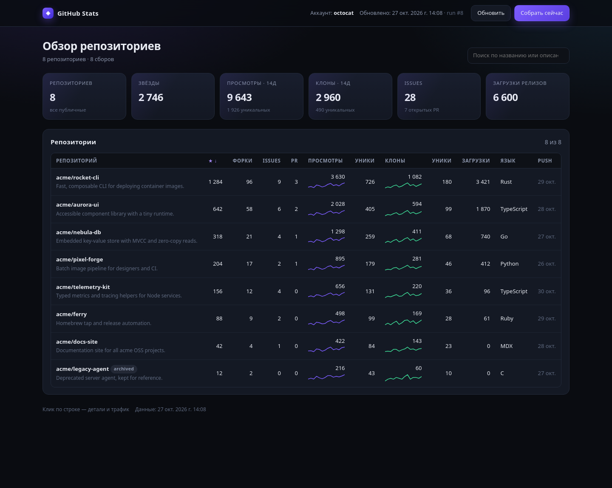
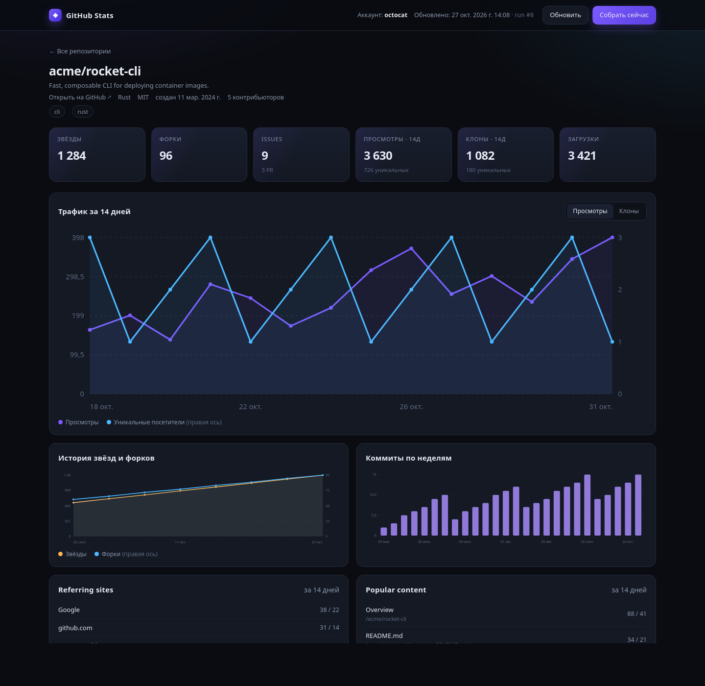

# github-stats

Local-first analytics for your GitHub repositories: stars, forks, issues, pull requests, releases, traffic, referrers, languages and commit activity — collected into SQLite, queryable from the terminal and viewable in a built-in web dashboard.

No dependencies. Python standard library only.



## Features

- **Repository snapshot** — stars, forks, watchers, open issues, open PRs, subscribers, size, language, last push, release downloads.
- **Traffic** — views, unique visitors, clones, unique cloners for the last 14 days, with daily breakdown.
- **Referrers & popular content** — traffic sources and top paths, exactly as shown on GitHub.
- **Activity** — weekly commit activity, contributor count, language breakdown.
- **History** — every run is stored, so you keep data longer than GitHub's 14-day traffic window.
- **Terminal reports** — table reports, per-repository history, sparkline-style charts, top lists.
- **Web dashboard** — sortable/searchable repository table, per-repo traffic charts, history graphs and a "collect now" button.
- **Works with private repositories** — if the token has access.

## Requirements

- Python 3.8+
- A GitHub token (classic `repo` scope, or a fine-grained token with **Administration: read** access)

## Install

```bash
git clone https://github.com/nohau1/github-stats.git
cd github-stats
chmod +x github_stats.py
```

Nothing to install — the script has no third-party dependencies.

## Authentication

Create a token at <https://github.com/settings/tokens>:

- **Classic** — scope `repo` (full access to private repositories, traffic and higher rate limits).
- **Fine-grained** — repository access + `Administration: read` (needed for traffic), `Metadata: read`.

Save it locally (the input is hidden and the file is written with `0600`):

```bash
./github_stats.py token
```

The token is stored at `~/.config/github-stats/token`. You can also pass `--token`, or set `GITHUB_TOKEN` / `GH_TOKEN`.

## Usage

```bash
# collect a new snapshot of every repository
./github_stats.py collect

# summary table of the latest snapshot with deltas
./github_stats.py report
./github_stats.py report --sort visitors --limit 10

# all traffic metrics for one repository
./github_stats.py traffic my-repo

# history for one repository
./github_stats.py history my-repo --days 30

# terminal chart for one metric
./github_stats.py chart my-repo --metric clones --days 30

# ranking across repositories
./github_stats.py top --metric views
```

Available metrics: `stars`, `forks`, `watchers`, `issues`, `prs`, `subs`, `network`, `size`, `downloads`, `views`, `visitors`, `clones`, `cloners`, `commits`.

### Collect only selected repositories

```bash
./github_stats.py collect --repo my-repo --repo other-repo
```

## Web dashboard



```bash
./github_stats.py serve              # http://127.0.0.1:8765, opens the browser
./github_stats.py serve --no-open
./github_stats.py serve --port 9000
```

The dashboard reads the SQLite database directly and can trigger a collection from the UI. It binds to `127.0.0.1` by default and has no authentication — do not expose it to the internet as is.

Stop it with `Ctrl+C` (or `fuser -k 8765/tcp` if it was started in the background).

Screenshots above use synthetic demo data.

## Scheduling

Collect every 6 hours with cron:

```cron
15 */6 * * * /usr/bin/python3 /home/USER/github-stats/github_stats.py collect >> /home/USER/.local/share/github-stats/cron.log 2>&1
```

GitHub keeps traffic data for only 14 days. Running `collect` regularly is what makes long-term history possible.

## Data

| Path | Purpose |
|---|---|
| `~/.local/share/github-stats/stats.db` | SQLite database with all snapshots |
| `~/.config/github-stats/token` | GitHub token (`0600`) |

Use `--db` to point at another database.

## How it works

`collect` lists repositories available to the token (`owner`, `collaborator` and `organization_member` affiliations), then for each repository fetches metadata, releases, contributors, languages, commit activity and — when the token has push access — traffic views, clones, referrers and popular paths. Each run is stored as a snapshot, so deltas and history can be computed over time.

## Limitations

- GitHub exposes traffic only for the last 14 days and only to users with push access.
- Repository graphs (Pulse, Traffic, Contributors, etc.) can be gated in the web UI on the free plan for private repositories; the REST API used here checks repository permissions instead.
- API rate limits apply (5,000 requests/hour for an authenticated token).
- Only the default branch is analyzed for languages and commit activity.

## License

MIT — see [LICENSE](LICENSE).
